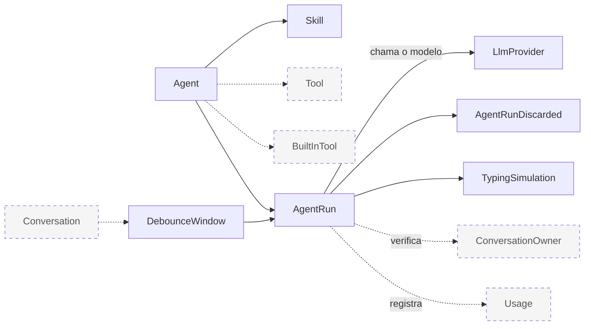

# Contexto: Agente (`agent`)

## Propósito do contexto

Configura o único `Agent` do MVP e executa o seu ciclo: juntar as mensagens do contato (debounce), montar o contexto, chamar o modelo, chamar ferramentas e enviar a resposta com naturalidade. Também decide quando uma execução é interrompida ou descartada.

Termos e nomes de código seguem o [glossário](../ubiquitous-language.md).

## Diagrama de entidades

Entidades tracejadas pertencem a outro contexto.

## Entidades e regras

- **`Agent`**: nome, modelo, instruções, skills, ferramentas, limites e parâmetros.
- **`Skill`**: bloco de instrução nomeado e reutilizável, associado ao agente.
- **`DebounceWindow`**: tempo de espera para juntar mensagens seguidas do contato.
- **`AgentRun`**: um ciclo do agente sobre um lote de mensagens (chamadas ao modelo, ferramentas, resposta, custo).
- **`AgentRunDiscarded`**: execução que não enviou, com motivo (`superseded_by_new_message` ou `human_takeover`).
- **`TypingSimulation`**: "digitando…" mais um atraso proporcional ao tamanho da resposta.
- **`LlmProvider`**: interface para chamar o modelo. O OpenRouter é a primeira implementação.

Regras:

- Se o dono da conversa é o agente, a mensagem do contato abre a `DebounceWindow` ou a **reinicia**.
- Ao fechar a janela, uma `AgentRun` começa. **Antes de começar, o dono da conversa é verificado de novo**: se virou humano, nada acontece.
- Só existe **uma execução por conversa por vez**.
- Se chega mensagem nova do contato enquanto a execução ainda não enviou a resposta (pensando, chamando ferramenta ou "digitando"), a execução é **interrompida** (a chamada ao modelo é abortada quando possível). A nova janela começa e a próxima execução recebe **todas** as mensagens juntas.
- **Proteção contra spam:** há um máximo de interrupções seguidas por conversa. Ao atingir, a próxima execução não é mais interrompida e envia a resposta. As mensagens que chegarem nesse meio tempo entram na execução seguinte. O limite de gasto por conversa é a última barreira.
- Antes de enviar a resposta, e depois da espera da digitação, o dono da conversa é verificado **mais uma vez**. Se mudou, a resposta não sai.
- Toda execução que não chega a enviar é registrada como **descartada**, com o motivo e os tokens e o custo gastos.
- **Contexto** da execução: instruções do agente, skills, as últimas N mensagens da conversa e a descrição das ferramentas.
- O modelo pode chamar ferramentas em sequência até o máximo de iterações por execução. Passou disso, a execução termina e é feito handoff para humano.
- A resposta final é enviada pelo conector como texto.
- Sem frameworks de agente: a chamada é direta à API compatível com OpenAI do OpenRouter, atrás da interface `LlmProvider`.
- **Áudio:** o agente recebe a indicação de que há um áudio que ele não consegue ouvir.
- **Simulação de digitação:** antes de enviar cada mensagem, mostra "digitando…" (se o conector suporta) e espera um tempo proporcional ao tamanho da mensagem.
- **Ordem do envio automático:** lista negra, travas de envio e simulação de digitação, com o dono da conversa verificado logo antes de enviar.
- Quando a execução falha (erro do provedor de modelo, por exemplo), a falha é registrada e `AgentRunFailed` é emitido.

## Eventos que emite / consome

- **Emite:** `AgentRunFailed`. Pede handoff (`ConversationHandedOff`) quando o limite de iterações é atingido.
- **Consome:** mensagens do contato gravadas no contexto de [conversas](conversations.md). Reage a mudanças do dono da conversa (`human_takeover` descarta a execução em andamento).

## Configuráveis

Todos por agente. O tempo do debounce e os parâmetros da simulação de digitação são configurados na conexão (ver [canais](channels.md)); o agente apenas os lê.

| Item | Padrão |
|---|---|
| Nome, modelo (entre os do OpenRouter) e instruções | sem padrão |
| Mensagens de histórico (N) | a cargo de quem implementa |
| Máximo de iterações por execução | 5 |
| Máximo de interrupções seguidas por conversa | 3 |

## Requisitos

- REQ-AG-01 Configurar o agente
- REQ-AG-02 Skills e associação ao agente
- REQ-AG-03 Janela de debounce
- REQ-AG-04 Uma execução por conversa e dono da conversa verificado ao começar
- REQ-AG-05 Executar a AgentRun
- REQ-AG-06 Interromper por mensagem nova
- REQ-AG-07 Máximo de interrupções seguidas
- REQ-AG-08 Dono da conversa verificado antes de enviar
- REQ-AG-09 Simulação de digitação
- REQ-AG-10 Áudio vira indicação para o agente
- REQ-AG-11 Ordem do envio automático

## Fora do MVP

- Vários agentes, agente roteador e transferência entre agentes.
- Frameworks de agente (LangChain, LangGraph e afins).
- Outros provedores de modelo além do OpenRouter.
- Transcrição de áudio.
- Skill interna que melhora as instruções escritas por não-programadores.
