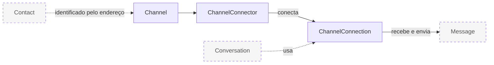

# Contexto: Canais (`channels`)

## Propósito do contexto

Isola o acesso ao WhatsApp atrás de uma interface de canal. O contexto recebe o webhook do provedor, normaliza para um formato único, descarta o que o produto ignora (grupos, ligações e status) e envia texto pela conexão. A Evolution é apenas o primeiro conector: nenhuma parte do domínio a conhece pelo nome.

Termos e nomes de código seguem o [glossário](../ubiquitous-language.md).

## Diagrama de entidades

Entidades tracejadas pertencem a outro contexto ([conversas](conversations.md)).

## Entidades e regras

- **`Channel`**: tipo de meio de comunicação (WhatsApp).
- **`ChannelConnector`**: implementação de um provedor de canal (Evolution). É uma interface com adaptadores.
- **`ChannelConnection`**: o número do negócio conectado por um conector. Guarda também o tempo do debounce e os parâmetros da simulação de digitação, que valem para todo atendimento por esse número, qualquer que seja o agente. O segredo de acesso não aparece em respostas da API nem em log.

Regras:

- O conector recebe o webhook do provedor e o **normaliza** para um formato único do canal, distinguindo: mensagem do contato (texto ou áudio), mensagem enviada pelo próprio número do negócio (`fromMe`), ligação, grupo e status.
- Grupos, ligações e status/broadcast são **descartados, com log**. O agente nunca responde a eles.
- O conector envia texto pela conexão e devolve o id externo do provedor. Esse id permite reconhecer o eco da mensagem depois.
- O número do negócio é o número conectado (`ChannelConnection`). O humano "fala na conversa" quando responde pelo WhatsApp desse mesmo número (celular ou WhatsApp Web).
- O eco de uma mensagem enviada pelo sistema pode chegar antes de o envio terminar. O conector precisa tratar esse caso.
- O "digitando…" é uma **capacidade opcional** do conector. Um conector sem ela só aplica o atraso da simulação de digitação.
- O usuário consulta o status da conexão pela API de gestão.

## Eventos que emite / consome

- **Emite:** nenhum evento do domínio próprio. O resultado da normalização segue para o contexto de [conversas](conversations.md), que grava a mensagem.
- **Consome:** nenhum evento. Recebe pedidos de envio de texto e de presença "digitando" dos outros contextos.

## Configuráveis

- Dados da conexão com a Evolution, informados pela API de gestão.
- O token de acesso da Evolution é guardado cifrado.

| Item | Padrão |
|---|---|
| Tempo da janela de debounce (`DebounceWindow`) | 8 s |
| Velocidade de digitação (caracteres por segundo), atraso mínimo e atraso máximo (`TypingSimulation`) | a cargo de quem implementa, com base em velocidade humana de digitação e limitados por um teto |

O spec não define valores padrão para os dados da conexão com a Evolution.

## Requisitos

- REQ-CH-01 Conector desacoplado
- REQ-CH-02 Registrar a conexão
- REQ-CH-03 Normalizar o webhook do provedor
- REQ-CH-04 Ignorar grupos, ligações e status
- REQ-CH-05 Enviar texto e registrar o id externo
- REQ-CH-06 Consultar o status da conexão
- REQ-CH-07 "Digitando…" como capacidade opcional

## Fora do MVP

- Outros conectores além da Evolution (Meta, Z-API, Baileys).
- Prospecção ativa, campanhas e importação de contatos.
- Transcrição de áudio: o áudio é só registrado como mensagem de áudio.
