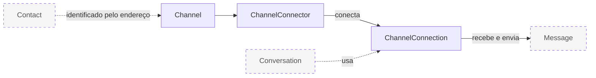

# Contexto: Canais (`channels`)

## Propósito do contexto

Isola o acesso ao WhatsApp atrás de uma interface de canal. O contexto recebe o webhook do provedor, normaliza para um formato único, descarta o que o produto ignora (grupos, ligações e status) e envia texto pela conexão. A Evolution é apenas o primeiro conector: nenhuma parte do domínio a conhece pelo nome.

Termos e nomes de código seguem o [glossário](../ubiquitous-language.md).

## Diagrama de entidades

Entidades tracejadas pertencem a outro contexto ([conversas](conversations.md)).

## Entidades e regras

- **`Channel`**: tipo de meio de comunicação (WhatsApp; no futuro, Instagram).
- **`ChannelConnector`**: implementação de um provedor de canal (Evolution; no futuro, OpenWA, GOWA, Z-API, Meta e Baileys). É uma interface com adaptadores.
- **`ChannelConnection`**: o número (ou a conta) do negócio conectado por um conector. Guarda o canal, o conector e os dados de acesso do conector, que variam de um conector para outro (URL, instância, um ou mais segredos, estado de sessão). Os segredos são guardados cifrados e não aparecem em respostas da API nem em log.

Regras:

- O conector recebe o webhook do provedor e o **normaliza** para um formato único do canal, distinguindo: mensagem do contato (texto ou áudio), mensagem enviada pelo próprio número do negócio (`fromMe`), ligação, grupo e status.
- O webhook da Evolution chega em `POST /webhooks/evolution/:connectionId` com o header `x-webhook-token`. O token é devolvido uma vez, no registro da conexão; configure-o nos `headers` do `/webhook/set/{instance}` da Evolution.
- O resultado da normalização é uma [`ChannelInbound`](../ubiquitous-language.md). Imagens e Canais do WhatsApp (`@newsletter`) viram `unsupported`. O endereço do contato é o `remoteJid` como o provedor envia, que pode ser um id de privacidade do WhatsApp (`@lid`) em vez do número de telefone. Como identificar o `Contact` (LID ou telefone) é decidido no M1.4.
- Grupos, ligações e status/broadcast são **descartados, com log**. O agente nunca responde a eles. O mesmo vale para os Canais do WhatsApp (`@newsletter`), o conteúdo que o MVP não trata (imagem, figurinha) e os outros eventos do provedor. A linha de log `channel inbound discarded` traz o motivo (`InboundDiscardReason`, no [glossário](../ubiquitous-language.md)).
- O conector envia texto pela conexão e devolve o id externo do provedor. Esse id permite reconhecer o eco da mensagem depois.
- O número do negócio é o número conectado (`ChannelConnection`). O humano "fala na conversa" quando responde pelo WhatsApp desse mesmo número (celular ou WhatsApp Web).
- O eco de uma mensagem enviada pelo sistema pode chegar antes de o envio terminar. O conector precisa tratar esse caso.
- O "digitando…" é uma **capacidade opcional** do conector. Um conector sem ela só aplica o atraso da simulação de digitação.
- O usuário consulta o status da conexão pela API de gestão.

## Eventos que emite / consome

- **Emite:** nenhum evento do domínio próprio. O resultado da normalização segue para o contexto de [conversas](conversations.md), que grava a mensagem.
- **Consome:** nenhum evento. Recebe pedidos de envio de texto e de presença "digitando" dos outros contextos.

## Configuráveis

- Dados da conexão com a Evolution, informados pela API de gestão em `POST /channel-connections/evolution`: URL do servidor (`baseUrl`), nome da instância (`instanceName`) e chave de API (`apiKey`). A resposta traz a conexão sem a chave.
- As conexões registradas são listadas em `GET /channel-connections`, sem nenhum segredo.
- O token de acesso da Evolution é guardado cifrado.

O tempo da janela de debounce e os parâmetros da simulação de digitação **não ficam na conexão**: no MVP são padrões fixos (ver [agente](agent.md)). Configurá-los por conexão está no [roadmap](../roadmap.md).

O spec não define valores padrão para os dados da conexão com a Evolution.

## Requisitos

- REQ-CH-01 Conector desacoplado
- REQ-CH-02 Registrar a conexão
- REQ-CH-03 Normalizar o webhook do provedor
- REQ-CH-04 Ignorar grupos, ligações e status
- REQ-CH-05 Enviar texto e registrar o id externo
- REQ-CH-06 Consultar o status da conexão
- REQ-CH-07 "Digitando…" como capacidade opcional

## Fora do MVP

- Outros conectores além da Evolution (OpenWA, GOWA, Z-API, Meta e Baileys) e o canal Instagram.
- Prospecção ativa, campanhas e importação de contatos.
- Transcrição de áudio: o áudio é só registrado como mensagem de áudio.
