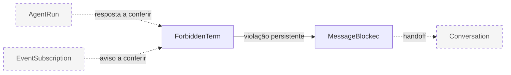

# Contexto: Lista negra (`content-guard`)

## Propósito do contexto

Guardrail de conteúdo: define o que **nunca pode sair** numa mensagem automática. Antes de cada envio automático, o texto é conferido, e com termo proibido a mensagem não sai.

Termos e nomes de código seguem o [glossário](../ubiquitous-language.md). Não confundir com a lista de bloqueio de **contatos**, que fica fora do MVP.

## Diagrama de entidades

Entidades tracejadas pertencem a outro contexto.

## Entidades e regras

- **`ForbiddenTerm`**: palavra ou frase que nunca pode sair numa mensagem automática. Pode ter um motivo.

Regras:

- Os itens são do tipo **palavra** ou **frase**, comparados sem diferenciar maiúsculas e acentos.
- **Sem expressão regular** no MVP.
- Antes de **cada envio automático** (resposta do agente e avisos de ouvintes), o texto é conferido. Com termo proibido, **não sai**.
- Resposta do agente bloqueada: o agente recebe os termos violados e tem **uma** chance de reescrever (conta como iteração).
- Se a reescrita ainda violar, a mensagem não sai, é feito handoff para humano e `MessageBlocked` é emitido.
- Na ordem do envio automático, a lista negra é a primeira etapa, antes das travas de envio e da simulação de digitação.

## Eventos que emite / consome

- **Emite:** `MessageBlocked`, quando a reescrita ainda viola. O handoff emite também `ConversationHandedOff`.
- **Consome:** nenhum evento. É consultado a cada envio automático.

## Configuráveis

| Item | Padrão |
|---|---|
| Termos da lista (palavra ou frase, com motivo opcional) | lista vazia (o spec não define termos) |
| Chances de reescrever | 1 (fixo no spec) |

## Requisitos

- REQ-CG-01 Cadastrar termos da lista negra
- REQ-CG-02 Comparação sem maiúsculas e acentos
- REQ-CG-03 Conferir antes de cada envio automático
- REQ-CG-04 Uma chance de reescrever

## Fora do MVP

- Termos por expressão regular.
- Lista de bloqueio de contatos e modo teste.
