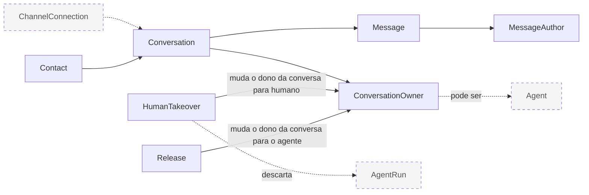

# Contexto: Conversas (`conversations`)

## Propósito do contexto

Guarda a thread entre a conexão e o contato, as mensagens e quem está no comando. É aqui que mora a convivência entre agente e humano: o dono da conversa (`ConversationOwner`) muda automaticamente quando o humano fala e volta ao agente quando o humano devolve. O anti-objetivo principal do produto, o agente responder enquanto o humano está no comando, é decidido neste contexto.

Termos e nomes de código seguem o [glossário](../ubiquitous-language.md).

## Diagrama de entidades

Entidades tracejadas pertencem a outro contexto.

## Entidades e regras

- **`Contact`**: a pessoa do outro lado, identificada pelo endereço no canal (telefone/JID).
- **`Conversation`**: a thread entre uma conexão e um contato. Tem um dono da conversa atual.
- **`Message`**: uma mensagem da conversa, com direção e autor.
- **`MessageAuthor`**: `contact`, `agent` ou `human`.
- **`ConversationOwner`**: quem está no comando agora, um agente ou humano.
- **`HumanTakeover`**: handoff disparado porque o humano falou na conversa.
- **`Release`**: o humano devolve a conversa ao agente.

Regras:

- Toda mensagem recebida é gravada de forma **idempotente pelo id externo**, encontrando ou criando `Contact` e `Conversation`.
- O dono da conversa nova é configurável (agente ou humano). O padrão é o agente.
- **Humano assume automaticamente:** chega pelo conector uma mensagem enviada pelo número do negócio que não foi enviada pelo sistema, e isso é um `HumanTakeover`. A mensagem é gravada com autor `human`.
- Para distinguir, toda mensagem que o sistema envia é registrada com o id externo. O eco que volta pelo webhook é reconhecido e ignorado, inclusive quando chega antes de o envio terminar.
- **Devolver ao agente:** por um endpoint de API (no futuro, um botão).
- Enquanto o dono da conversa é humano, as mensagens do contato são gravadas normalmente e o agente não age: não abre `DebounceWindow`, não inicia `AgentRun` e não envia nada.
- No MVP, o dono da conversa é "um agente" ou "humano", e não "o agente", para não impedir vários agentes no futuro.

## Eventos que emite / consome

- **Emite:** `MessageReceived` e, no `HumanTakeover`, o evento de handoff `ConversationHandedOff`.
- **Consome:** nenhum evento. Recebe a mensagem normalizada do contexto de [canais](channels.md) e pedidos de handoff dos contextos do agente, de [ferramentas](tools.md), de [travas de envio](sending-guards.md) e de [lista negra](content-guard.md).

## Configuráveis

| Item | Padrão |
|---|---|
| Dono de uma conversa nova (agente ou humano) | agente |

O tempo da `DebounceWindow` não é configurado aqui: a janela da conversa lê o valor da `ChannelConnection` (ver [canais](channels.md)).

## Requisitos

- REQ-CV-01 Gravar a mensagem de forma idempotente
- REQ-CV-02 Dono da conversa inicial configurável
- REQ-CV-03 Humano assume ao falar
- REQ-CV-04 Reconhecer o eco das mensagens do sistema
- REQ-CV-05 Devolver a conversa ao agente
- REQ-CV-06 Agente inerte com dono da conversa humano

## Fora do MVP

- Vários agentes e transferência entre agentes. O handoff é só do agente para humano.
- Lista de bloqueio de contatos e modo teste.
- Botão de devolução na interface: no MVP, só o endpoint de API.
