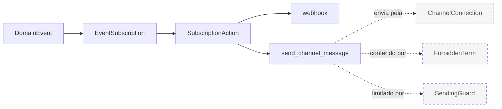

# Contexto: Eventos (`events`)

## Propósito do contexto

Permite que o domínio avise o mundo sobre o que aconteceu e que outros reajam sem acoplamento. O sistema emite eventos de domínio, e ouvintes executam ações (webhook externo ou envio de WhatsApp). É a base para o agente conviver com outros agentes e automações (n8n, outros sistemas).

Termos e nomes de código seguem o [glossário](../ubiquitous-language.md).

## Diagrama de entidades

Entidades tracejadas pertencem a outro contexto.

## Entidades e regras

- **`DomainEvent`**: fato ocorrido no domínio. Mínimo do MVP: `MessageReceived`, `ConversationHandedOff`, `SpendingLimitReached`, `SendingLimitReached`, `MessageBlocked`, `AgentRunFailed`.
- **`EventSubscription`**: regra "quando ocorrer o evento X, execute a ação Y".
- **`SubscriptionAction`**: `webhook` (POST do evento para uma URL externa) ou ação interna `send_channel_message` (envia uma mensagem pela conexão para um endereço configurável, com um modelo de texto que pode usar dados do evento).

Regras:

- `SpendingLimitReached` é **um evento só** para os dois limites de gasto, com o campo `scope` (`conversation` ou `agent_daily`).
- **As duas ações têm a mesma forma.** O aviso por WhatsApp é só um ouvinte interno já cadastrado. Um mesmo evento pode ter vários ouvintes (o aviso mais quantos webhooks quiser).
- Todo ouvinte pode ser **ligado ou desligado**.
- Ouvintes do sistema (como o aviso de handoff) vêm cadastrados, podem ser editados e desligados, mas **não apagados**.
- O aviso de handoff é enviado ao número de notificação, com o resumo. Número e texto podem ser editados.
- Ouvintes são executados de forma **assíncrona (fila)**, com novas tentativas em caso de erro. Uma falha do ouvinte não afeta quem emitiu o evento.
- O envio da ação `send_channel_message` passa pela lista negra e pelas travas de envio.

## Eventos que emite / consome

- **Emite:** nenhum evento próprio. O contexto entrega os eventos dos outros contextos.
- **Consome:** todos os eventos do mínimo do MVP, emitidos por [conversas](conversations.md), [agente](agent.md), [ferramentas](tools.md), [travas de envio](sending-guards.md), [lista negra](content-guard.md) e [gasto](usage.md).

## Configuráveis

| Item | Padrão |
|---|---|
| Ouvintes (evento, ação, ligado ou desligado) | o ouvinte do sistema do aviso de handoff vem cadastrado |
| Número de notificação e texto do aviso | sem padrão definido no spec |
| Endereço e modelo de texto da ação `send_channel_message` | sem padrão |
| URL da ação `webhook` | sem padrão |

## Requisitos

- REQ-EV-01 Publicar eventos e entregar por fila
- REQ-EV-02 Ouvinte do tipo webhook
- REQ-EV-03 Ação `send_channel_message`
- REQ-EV-04 Ligar e desligar ouvintes
- REQ-EV-05 Ouvinte do sistema para o aviso de handoff
- REQ-EV-06 Falha da execução

## Fora do MVP

- Vários agentes ouvindo e emitindo eventos entre si (a base está pronta, o uso fica no roadmap).
- Outras ações de ouvinte além de `webhook` e `send_channel_message`.
