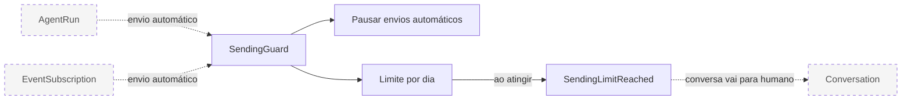

# Contexto: Travas de envio (`sending-guards`)

## Propósito do contexto

Protege o número do negócio contra banimento do WhatsApp por comportamento de robô. As travas valem para **todo envio automático** (respostas do agente e avisos de ouvintes). Mensagens do humano pelo celular não passam por aqui.

Termos e nomes de código seguem o [glossário](../ubiquitous-language.md).

## Diagrama de entidades

Entidades tracejadas pertencem a outro contexto.

## Entidades e regras

- **`SendingGuard`**: regra que limita os envios automáticos para proteger o número. No MVP há duas:
  - **Pausar envios automáticos:** interruptor geral. Ligado, o agente não envia nada.
  - **Limite por dia:** máximo de envios automáticos por dia, contado no fuso configurável.

Regras:

- Envio bloqueado por trava: a mensagem não sai e o bloqueio é registrado.
- Se for o limite diário, emite `SendingLimitReached` e a conversa vai para humano.
- Na ordem do envio automático, as travas vêm depois da lista negra e antes da simulação de digitação.

## Eventos que emite / consome

- **Emite:** `SendingLimitReached`, ao bloquear pelo limite diário. O handoff da conversa emite também `ConversationHandedOff`.
- **Consome:** nenhum evento. É consultado a cada envio automático.

## Configuráveis

| Item | Padrão |
|---|---|
| Pausa de envios automáticos | o spec não define |
| Limite de envios por dia | a cargo de quem implementa (documentado) |
| Fuso para contar o dia | a cargo de quem implementa (documentado) |

## Requisitos

- REQ-SG-01 Configurar as travas
- REQ-SG-02 Pausa bloqueia o envio automático
- REQ-SG-03 Limite diário de envios

## Fora do MVP

- Intervalo mínimo e máximo entre primeiras mensagens: só faz sentido quando o agente inicia conversas (prospecção, roadmap).
- Prospecção ativa e campanhas.
