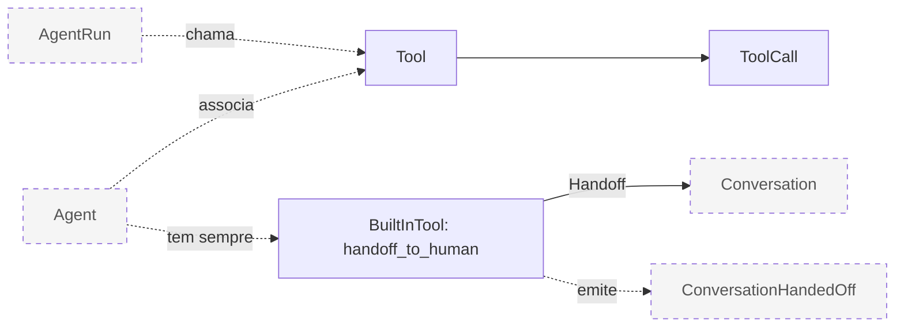

# Contexto: Ferramentas (`tools`)

## Propósito do contexto

Dá ao agente capacidades que ele escolhe chamar. No MVP, toda `Tool` é um webhook, e todo agente tem a `BuiltInTool` `handoff_to_human`, que passa a conversa para uma pessoa.

Termos e nomes de código seguem o [glossário](../ubiquitous-language.md).

## Diagrama de entidades

Entidades tracejadas pertencem a outro contexto.

## Entidades e regras

- **`Tool`**: capacidade que o agente pode chamar. Tem nome, descrição para o modelo, parâmetros (JSON Schema), URL, método e cabeçalhos. Os cabeçalhos podem conter segredos, guardados cifrados.
- **`BuiltInTool`**: ferramenta que todo agente tem. No MVP, `handoff_to_human`, com motivo e resumo.
- **`ToolCall`**: registro de uma chamada (argumentos, resposta, duração, erro).

Regras:

- O agente decide quando chamar as ferramentas associadas. A descrição e os parâmetros delas são expostos ao modelo.
- **Contrato da chamada:** `POST` para a URL com JSON `{ tool, arguments, conversation: { id }, contact: { id, address, name } }`.
- A resposta (JSON ou texto) é entregue ao modelo como resultado da ferramenta.
- Timeout, erro HTTP ou erro de rede: o modelo recebe um resultado de erro claro e decide o que dizer. Tudo fica registrado em `ToolCall`.
- O modelo pode chamar ferramentas em sequência até o máximo de iterações por execução. Passou disso, a execução termina e é feito handoff para humano.
- O handoff acontece quando: o cliente pede uma pessoa, o agente não sabe resolver, o limite de iterações é atingido, ou um limite de gasto é atingido. Os contextos de [travas de envio](sending-guards.md) e de [lista negra](content-guard.md) também levam a conversa a humano.
- Todo handoff emite `ConversationHandedOff`, com motivo e resumo.

## Eventos que emite / consome

- **Emite:** `ConversationHandedOff` (motivo e resumo), a cada handoff.
- **Consome:** nenhum evento. É chamado pela `AgentRun` do contexto do [agente](agent.md).

## Configuráveis

| Item | Padrão |
|---|---|
| Timeout da chamada (variável de ambiente, validada na subida) | 10 s (padrão sugerido) |
| Máximo de iterações por execução (por agente) | 5 |
| Ferramentas associadas ao agente | nenhuma |

## Requisitos

- REQ-TL-01 Cadastrar ferramenta por webhook
- REQ-TL-02 Associar ferramentas ao agente e expô-las ao modelo
- REQ-TL-03 Contrato da chamada
- REQ-TL-04 Timeout, erros e registro da chamada
- REQ-TL-05 Máximo de iterações por execução
- REQ-TL-06 Ferramenta padrão `handoff_to_human`
- REQ-TL-07 Quando o handoff acontece

## Fora do MVP

- Ferramentas que não sejam webhook.
- Transferência entre agentes: o handoff é só para humano.
