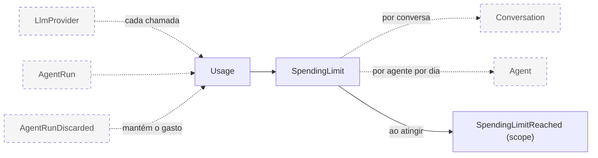

# Contexto: Gasto (`usage`)

## Propósito do contexto

Guardrail de gasto. Registra modelo, tokens e custo de cada chamada ao modelo e trava a execução ao passar dos limites, para o agente não entrar em loop nem gastar sem controle.

Termos e nomes de código seguem o [glossário](../ubiquitous-language.md).

## Diagrama de entidades

Entidades tracejadas pertencem a outro contexto.

## Entidades e regras

- **`Usage`**: custo e tokens de chamadas ao modelo, com o modelo usado. O OpenRouter devolve o custo.
- **`SpendingLimit`**: teto por conversa e por agente por dia.

Regras:

- Toda chamada ao modelo registra **modelo usado**, tokens e custo, inclusive em execuções descartadas.
- O limite **por conversa** pega loop e abuso. O limite **por agente por dia** protege o bolso.
- Ao atingir um limite: a execução para, é feito handoff para humano e `SpendingLimitReached` é emitido com o `scope`.
- `SpendingLimitReached` é um evento só, com `scope` igual a `conversation` ou `agent_daily`.
- O limite por conversa é a última barreira contra o spam que interrompe toda execução.

## Eventos que emite / consome

- **Emite:** `SpendingLimitReached` (com `scope`). O handoff emite também `ConversationHandedOff`.
- **Consome:** nenhum evento. Recebe o registro de cada chamada ao modelo feita pela `AgentRun` do [agente](agent.md).

## Configuráveis

| Item | Padrão |
|---|---|
| Limite de gasto por conversa | o spec não define valor |
| Limite de gasto por agente por dia | o spec não define valor |

## Requisitos

- REQ-US-01 Registrar modelo, tokens e custo
- REQ-US-02 Limite por conversa
- REQ-US-03 Limite por agente por dia
- REQ-US-04 Efeito de atingir o limite

## Fora do MVP

- Outros provedores de modelo além do OpenRouter.
- Cobrança do cliente final e pagamentos.
