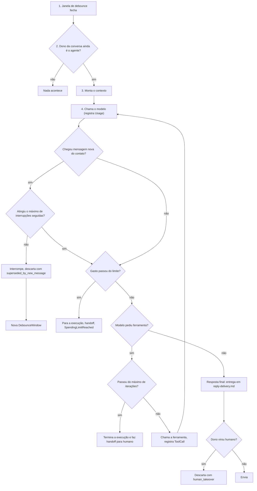

# Processo: execução do agente

## Objetivo

Responder ao lote de mensagens do contato com uma `AgentRun`: montar o contexto, chamar o modelo e as ferramentas e entregar a resposta final. A execução não pode responder se o humano estiver no comando, não pode ficar presa em loop e não pode gastar sem controle.

## Gatilho

O fechamento da `DebounceWindow` de uma conversa cujo dono da conversa é o agente (ver [`inbound-message.md`](inbound-message.md)).

## Entradas

- O lote de mensagens do contato que fecharam a janela (mais as que ficaram pendentes de interrupções anteriores).
- A configuração do `Agent`: instruções, skills, ferramentas, N mensagens de histórico, máximo de iterações (padrão 5), máximo de interrupções seguidas (padrão 3) e limites de gasto.
- O histórico recente da conversa (as últimas N mensagens).

## Saídas

- A resposta final do agente, entregue pelo processo [`reply-delivery.md`](reply-delivery.md).
- Um registro de `Usage` (modelo, tokens e custo) para cada chamada ao modelo, inclusive nas execuções descartadas.
- Ou um registro de `AgentRunDiscarded` com o motivo (`superseded_by_new_message` ou `human_takeover`).
- Ou um handoff para humano (ver [`handoff.md`](handoff.md)) por limite de iterações ou de gasto.
- Ou o evento `AgentRunFailed`, quando a execução falha (erro do provedor de modelo, por exemplo).

## Fluxo

1. A janela de debounce fecha e uma `AgentRun` está pronta para começar. **Só existe uma execução por conversa por vez.**
2. **Antes de começar, o dono da conversa é verificado de novo.** Se virou humano, nada acontece.
3. O contexto é montado com as instruções do agente, as skills, o histórico recente (as últimas N mensagens) e a descrição das ferramentas.
4. O sistema chama o modelo, direto pela interface `LlmProvider`, sem framework de agente. Toda chamada registra o modelo usado, os tokens e o custo.
5. O modelo pode chamar ferramentas em sequência, até o **máximo de iterações por execução** (padrão 5). Cada chamada fica registrada em `ToolCall`. Passou do máximo, a execução termina e é feito handoff para humano.
6. **Interrupção:** se chega mensagem nova do contato enquanto a execução ainda não enviou a resposta (pensando, chamando ferramenta ou "digitando"), a execução é interrompida e a chamada ao modelo é abortada quando possível. A nova janela de debounce começa, e a próxima execução recebe todas as mensagens juntas.
7. **Descarte com motivo:** toda execução que não chega a enviar é registrada como `AgentRunDiscarded`, com o motivo e os tokens e o custo gastos. Os motivos são `superseded_by_new_message` (mensagem nova do contato) e `human_takeover` (o humano assumiu).
8. **Proteção contra spam:** há um máximo de interrupções seguidas por conversa (padrão 3). Ao atingir o máximo, a próxima execução não é mais interrompida e envia a resposta. As mensagens que chegarem nesse meio tempo entram na execução seguinte.
9. **Custo:** a cada chamada ao modelo, o gasto acumulado é comparado com o `SpendingLimit` por conversa e por agente por dia. Ao atingir um limite, a execução para, é feito handoff para humano e `SpendingLimitReached` é emitido com o `scope` (`conversation` ou `agent_daily`). O limite de gasto por conversa é a última barreira contra o spam.
10. A resposta final segue para a entrega ([`reply-delivery.md`](reply-delivery.md)), onde o dono da conversa é verificado mais uma vez antes do envio.

## Casos de borda

- **Humano assume durante a execução:** a resposta não sai e a execução é descartada com `human_takeover`.
- **Rajada contínua do contato:** depois do máximo de interrupções seguidas, a execução envia a resposta mesmo com mensagem nova. A mensagem nova entra na execução seguinte.
- **Limite de iterações:** a execução termina sem enviar resposta ao contato e a conversa passa para humano.
- **Limite de gasto:** a execução para sem resposta ao contato, a conversa passa para humano e um único `SpendingLimitReached` é emitido.
- **Falha do provedor de modelo:** a falha é registrada, nada é enviado ao contato e `AgentRunFailed` é emitido.
- **Ferramenta com timeout ou erro:** o modelo recebe um resultado de erro claro e decide o que dizer. O erro fica registrado em `ToolCall`.
- **Áudio no lote:** o contexto traz a indicação de que há um áudio que o agente não consegue ouvir.
- **Execução descartada:** os tokens e o custo já gastos continuam registrados.

## Contextos envolvidos

- [Agente](../contexts/agent.md): `AgentRun`, contexto, iterações, interrupção e descarte.
- [Conversas](../contexts/conversations.md): dono da conversa e histórico de mensagens.
- [Ferramentas](../contexts/tools.md): chamadas de ferramenta e `ToolCall`.
- [Gasto](../contexts/usage.md): `Usage` e `SpendingLimit`.
- [Eventos](../contexts/events.md): `SpendingLimitReached`, `AgentRunFailed` e `ConversationHandedOff`.
