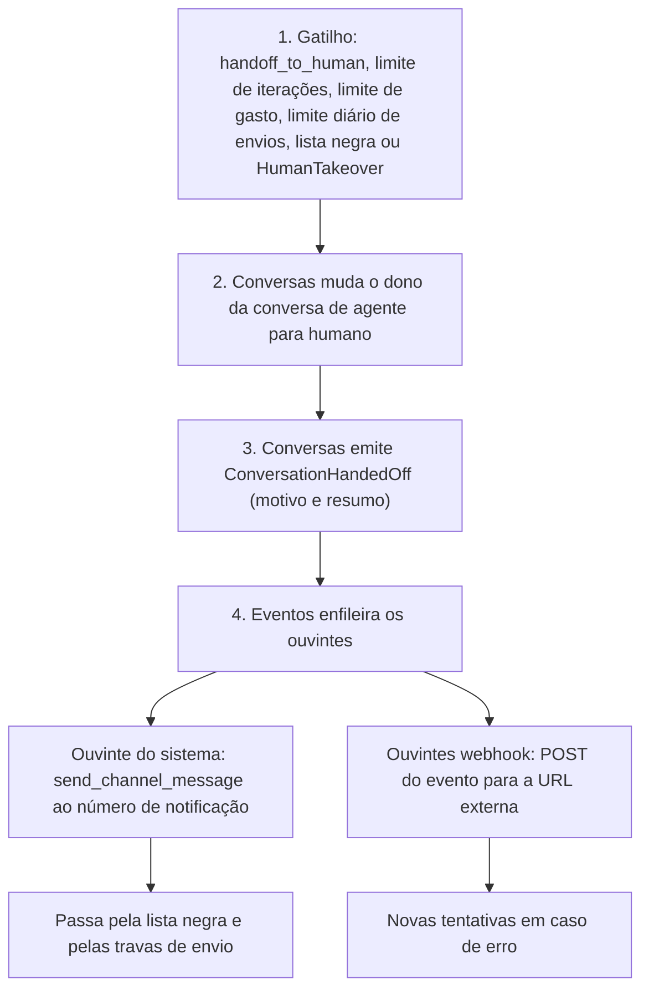

# Processo: handoff para humano

## Objetivo

Passar a conversa do agente para o humano, e avisar quem precisa saber. O handoff é a troca do dono da conversa; no MVP, sempre do agente para humano.

## Gatilho

Qualquer situação em que o dono da conversa muda de agente para humano. Os gatilhos são:

- o agente chama a ferramenta padrão `handoff_to_human` (o cliente pede uma pessoa ou o agente não sabe resolver);
- o limite de iterações por execução é atingido;
- um limite de gasto é atingido (por conversa ou por agente por dia);
- o limite diário de envios é atingido;
- a mensagem é bloqueada pela lista negra depois da reescrita;
- o humano fala na conversa (`HumanTakeover`).

## Entradas

- A conversa cujo dono da conversa é o agente.
- O motivo do handoff e, quando existir, o resumo (a ferramenta `handoff_to_human` recebe os dois).
- Os ouvintes (`EventSubscription`) cadastrados para `ConversationHandedOff`.

## Saídas

- O dono da conversa passa a ser humano, com o motivo registrado.
- O evento `ConversationHandedOff`, com motivo e resumo, **emitido pelo contexto de conversas sempre que o dono da conversa muda de agente para humano**.
- A execução dos ouvintes: o aviso por WhatsApp ao número de notificação e os webhooks cadastrados.

## Fluxo

1. Um dos gatilhos acima ocorre. O motivo acompanha o gatilho.
2. O contexto de conversas **muda o dono da conversa** de agente para humano. A partir daí, o agente fica inerte: as mensagens do contato continuam sendo gravadas, mas não abrem `DebounceWindow` nem iniciam `AgentRun`.
3. O contexto de conversas **emite `ConversationHandedOff`**, com motivo e resumo, sempre que o dono da conversa muda de agente para humano. Isso vale para todos os gatilhos, inclusive o `HumanTakeover`.
4. O contexto de eventos entrega o evento aos ouvintes, de forma assíncrona (fila), com novas tentativas em caso de erro:
   - o **ouvinte do sistema** envia o aviso por WhatsApp ao número de notificação, com o resumo (`send_channel_message`). Ele já vem cadastrado, pode ter número e texto editados e pode ser **desligado**, mas não apagado;
   - qualquer outro ouvinte cadastrado no evento é executado (por exemplo, um webhook para o n8n). Um mesmo evento pode ter vários ouvintes.

Alguns gatilhos emitem também o próprio evento, além de `ConversationHandedOff`: `SpendingLimitReached` (com o `scope` `conversation` ou `agent_daily`), `SendingLimitReached` e `MessageBlocked`.

## Casos de borda

- **Ouvinte do sistema desligado:** nenhum aviso é enviado, mas o handoff e o evento acontecem normalmente.
- **Aviso barrado:** o aviso do ouvinte também passa pela lista negra e pelas travas de envio. Com a pausa ligada, por exemplo, ele não sai e o bloqueio é registrado.
- **Falha de um webhook:** o ouvinte é executado de novo (novas tentativas); a falha de um ouvinte não desfaz o handoff.
- **Vários ouvintes no mesmo evento:** o aviso e quantos webhooks houver são executados.
- **`HumanTakeover`:** o humano já está no comando; mesmo assim o evento é emitido, porque o dono da conversa mudou de agente para humano.
- **Limite de gasto:** o `SpendingLimitReached` é um evento só para os dois limites, e a consequência é a mesma (handoff).

## Contextos envolvidos

- [Conversas](../contexts/conversations.md): muda o dono da conversa e emite `ConversationHandedOff`.
- [Ferramentas](../contexts/tools.md): a ferramenta padrão `handoff_to_human`.
- [Agente](../contexts/agent.md): limite de iterações e fim da execução.
- [Eventos](../contexts/events.md): ouvintes, fila e novas tentativas.
- [Gasto](../contexts/usage.md): limites de gasto e `SpendingLimitReached`.
- [Travas de envio](../contexts/sending-guards.md): limite diário e `SendingLimitReached`.
- [Conteúdo (lista negra)](../contexts/content-guard.md): `MessageBlocked`.
- [Canais](../contexts/channels.md): envio do aviso por WhatsApp.
