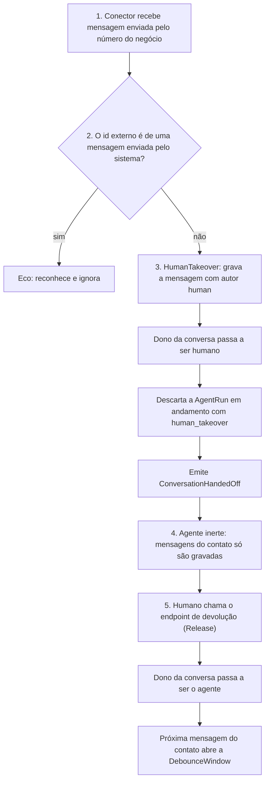

# Processo: o humano assume e devolve a conversa

## Objetivo

Garantir a convivência entre agente e humano na mesma conversa do WhatsApp: quando o humano fala pelo número do negócio, o agente se cala (`HumanTakeover`); quando o humano quer, devolve a conversa ao agente (`Release`). Responder enquanto o humano está no comando é a pior falha possível do produto.

## Gatilho

- **Assumir:** chega pelo conector uma mensagem enviada pelo número do negócio (celular ou WhatsApp Web).
- **Devolver:** o humano chama o endpoint de devolução da API.

## Entradas

- A mensagem enviada pelo número do negócio, com o id externo.
- O registro das mensagens enviadas pelo sistema, com o id externo.
- A conversa e o dono da conversa atual.
- Para a devolução: a conversa a devolver.

## Saídas

- **Assumir:** a mensagem gravada com autor `human`, o dono da conversa passando a ser humano e o evento `ConversationHandedOff` (ver [`handoff.md`](handoff.md)). Uma `AgentRun` em andamento é descartada com `human_takeover`.
- **Eco:** nenhuma mudança; a mensagem é reconhecida como do sistema e ignorada.
- **Devolver:** o dono da conversa passa a ser o agente.

## Fluxo

1. O conector recebe, pelo webhook, uma mensagem enviada pelo número do negócio e a normaliza (ver [`inbound-message.md`](inbound-message.md)).
2. **Eco ou humano.** Toda mensagem que o sistema envia é registrada com o id externo (ver [`reply-delivery.md`](reply-delivery.md)). Se a mensagem que chegou tem o id externo de uma mensagem enviada pelo sistema, é o **eco**: é reconhecida e ignorada, sem `HumanTakeover`.
3. **`HumanTakeover`.** Se a mensagem não foi enviada pelo sistema, o humano falou. A mensagem é gravada com autor `human`, o dono da conversa passa a ser humano e o `ConversationHandedOff` é emitido. Uma `AgentRun` em andamento nessa conversa é descartada com o motivo `human_takeover`, e a execução também confere o dono antes de começar e antes de enviar.
4. **Agente inerte.** Enquanto o dono da conversa é humano, as mensagens do contato são gravadas normalmente, e o agente não abre `DebounceWindow`, não inicia `AgentRun` e não envia nada.
5. **`Release`.** O humano devolve a conversa ao agente por um endpoint da API (no futuro, um botão). O dono da conversa passa a ser o agente, e uma mensagem nova do contato volta a abrir a `DebounceWindow`.

## Casos de borda

- **Condição de corrida do eco:** o eco pode chegar pelo webhook **antes** de o envio terminar e de o id externo ser gravado. O conector precisa tratar esse caso, para que o eco de uma mensagem do sistema não vire `HumanTakeover`. Essa corrida deve ser coberta por teste.
- **Humano fala durante a execução ou durante a espera de digitação:** nenhuma mensagem é enviada e a execução fica registrada como descartada com `human_takeover`, com os tokens e o custo já gastos.
- **Mensagem do contato com dono da conversa humano:** é gravada normalmente, sem efeito sobre o agente.
- **Aviso de handoff:** como todo `HumanTakeover` emite `ConversationHandedOff`, os ouvintes cadastrados para o evento são executados.

## Contextos envolvidos

- [Canais](../contexts/channels.md): recebe e normaliza a mensagem, reconhece o eco e trata a corrida.
- [Conversas](../contexts/conversations.md): `HumanTakeover`, `Release`, dono da conversa e gravação da mensagem.
- [Agente](../contexts/agent.md): descarta a `AgentRun` com `human_takeover` e fica inerte.
- [Eventos](../contexts/events.md): entrega `ConversationHandedOff` aos ouvintes.
