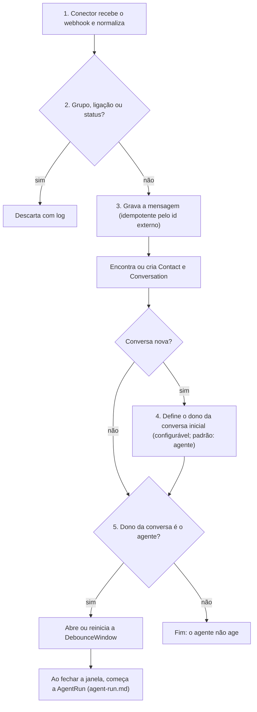

# Processo: mensagem recebida

## Objetivo

Transformar o webhook do provedor numa mensagem gravada na conversa certa e, quando o dono da conversa é o agente, abrir ou reiniciar a janela de debounce. Este processo termina onde começa a execução do agente ([`agent-run.md`](agent-run.md)).

## Gatilho

O provedor do canal (hoje a Evolution) chama o webhook do sistema com um evento de mensagem, ligação, grupo ou status.

## Entradas

- O payload bruto do provedor.
- A conexão (`ChannelConnection`) à qual o webhook pertence.
- A configuração do dono da conversa inicial das conversas novas (agente ou humano; padrão: agente).
- O tempo da janela de debounce do agente (padrão 8 s).

## Saídas

- Uma `Message` gravada, com `Contact` e `Conversation` encontrados ou criados.
- O evento `MessageReceived`.
- Se o dono da conversa é o agente: a `DebounceWindow` da conversa aberta ou reiniciada.
- Ou, nos casos descartados, apenas um log.

## Fluxo

1. O conector recebe o webhook do provedor e **normaliza** para um formato único do canal: mensagem do contato, mensagem enviada pelo próprio número do negócio, ligação, grupo, status.
2. Grupos, ligações e status são **descartados**, com log. Nada é gravado.
3. A mensagem é **gravada de forma idempotente** pelo id externo. O sistema encontra ou cria o `Contact` e a `Conversation`. Processar duas vezes o mesmo webhook resulta em uma única `Message`.
4. Se a conversa é nova, o **dono da conversa inicial** é o configurado: agente ou humano. O padrão é o agente.
5. Se o dono da conversa é o agente, a **`DebounceWindow`** da conversa é aberta ou, se já estiver aberta, **reiniciada**. O tempo é configurável por agente; o padrão é 8 s. Quando a janela fecha, começa a `AgentRun`.

Mensagens enviadas pelo próprio número do negócio seguem o fluxo de [`human-takeover-and-release.md`](human-takeover-and-release.md), que decide entre eco do sistema e fala do humano.

## Casos de borda

- **Webhook repetido:** a gravação idempotente pelo id externo garante uma única `Message`.
- **Dono humano:** a mensagem do contato é gravada normalmente, mas nenhuma `DebounceWindow` é aberta e o agente não age.
- **Rajada de mensagens:** três mensagens dentro da janela resultam em uma única `AgentRun` com as três mensagens.
- **Áudio:** é gravado como mensagem de áudio. O agente recebe a indicação de que há um áudio que ele não consegue ouvir (sem transcrição no MVP).
- **Mensagem do próprio número:** não abre debounce. É tratada como eco ou como `HumanTakeover`.

## Contextos envolvidos

- [Canais](../contexts/channels.md): recebe e normaliza o webhook, descarta grupos, ligações e status.
- [Conversas](../contexts/conversations.md): grava a mensagem, cria `Contact` e `Conversation`, define o dono da conversa inicial.
- [Agente](../contexts/agent.md): mantém a `DebounceWindow` e inicia a `AgentRun`.
- [Eventos](../contexts/events.md): entrega `MessageReceived` aos ouvintes.
