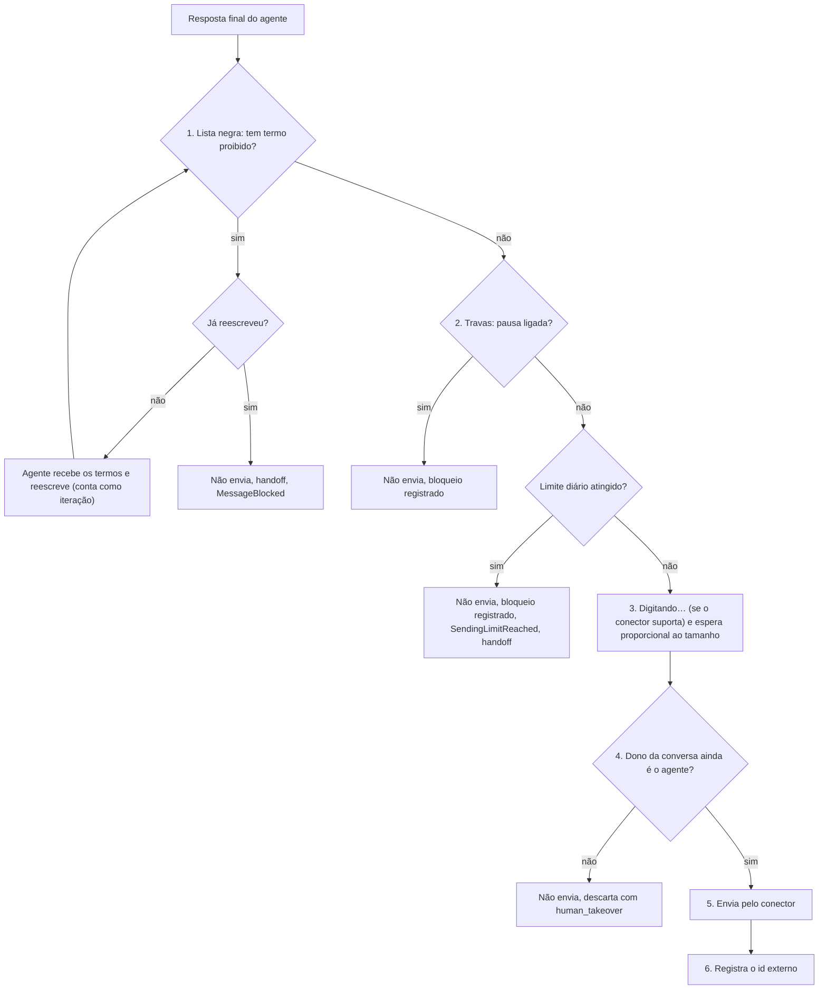

# Processo: entrega da resposta

## Objetivo

Levar a resposta final do agente até o contato, protegendo o número do negócio e a conversa. Todo envio automático passa, **nesta ordem**, pela lista negra, pelas travas de envio e pela simulação de digitação. O dono da conversa é verificado logo antes de enviar. Uma etapa que barra a mensagem impede as etapas seguintes.

## Gatilho

A `AgentRun` produz uma resposta final em texto (ver [`agent-run.md`](agent-run.md)).

## Entradas

- O texto da resposta do agente.
- Os termos da lista negra (`ForbiddenTerm`).
- A configuração das travas de envio: pausa, limite por dia e fuso.
- Os parâmetros da simulação de digitação do agente: velocidade (caracteres por segundo), atraso mínimo e atraso máximo.
- A capacidade do conector de mostrar "digitando…" (opcional).

## Saídas

- A mensagem enviada pelo conector, gravada com o id externo.
- Ou um bloqueio registrado (lista negra ou trava de envio), sem envio.
- Os eventos `MessageBlocked`, `SendingLimitReached` e `ConversationHandedOff`, conforme o caso.
- Ou uma execução descartada com `human_takeover`.

## Fluxo

1. **Lista negra.** O texto é conferido, sem diferenciar maiúsculas e acentos. Com termo proibido, a mensagem não sai. O agente recebe os termos violados e tem **uma** chance de reescrever (a reescrita conta como iteração). Se a reescrita ainda violar, a mensagem não sai, é feito handoff para humano e `MessageBlocked` é emitido.
2. **Travas de envio.** Com a pausa ligada, nada sai e o bloqueio é registrado. Com o limite diário de envios atingido (contado no fuso configurado), a mensagem não sai, o bloqueio é registrado, `SendingLimitReached` é emitido e a conversa vai para humano.
3. **Simulação de digitação.** O sistema mostra "digitando…" ao contato, quando o conector tem essa capacidade, e espera um tempo proporcional ao tamanho da mensagem, dentro do atraso mínimo e do máximo. Um conector sem a capacidade só aplica o atraso.
4. **Rechecagem do dono.** Depois da espera, logo antes de enviar, o dono da conversa é verificado mais uma vez. Se virou humano, a resposta não sai e a execução é descartada com `human_takeover`.
5. **Envio** pelo conector, como texto.
6. **Registro do id externo.** A mensagem enviada é registrada com o id externo, para que o eco que volta pelo webhook seja reconhecido (ver [`human-takeover-and-release.md`](human-takeover-and-release.md)).

## Casos de borda

- **Humano assume durante a espera de digitação:** nada é enviado e a execução fica registrada como `AgentRunDiscarded` com `human_takeover`, com os tokens e o custo já gastos.
- **Conector sem "digitando…":** só o atraso é aplicado.
- **Barrada por uma etapa:** as etapas seguintes não são executadas.
- **Avisos de ouvintes:** os envios automáticos dos ouvintes (como o aviso de handoff) também passam pela lista negra e pelas travas de envio. Mensagens do humano pelo celular não passam por este processo.
- **Eco chegando antes do registro do id externo:** o conector precisa tratar essa corrida (ver o processo de assumir e devolver).

## Contextos envolvidos

- [Conteúdo (lista negra)](../contexts/content-guard.md): confere o texto contra os termos proibidos.
- [Travas de envio](../contexts/sending-guards.md): pausa e limite diário.
- [Agente](../contexts/agent.md): reescrita, simulação de digitação e descarte da execução.
- [Canais](../contexts/channels.md): "digitando…", envio e id externo.
- [Conversas](../contexts/conversations.md): verificação do dono da conversa e registro da mensagem enviada.
- [Eventos](../contexts/events.md): `MessageBlocked`, `SendingLimitReached` e `ConversationHandedOff`.
