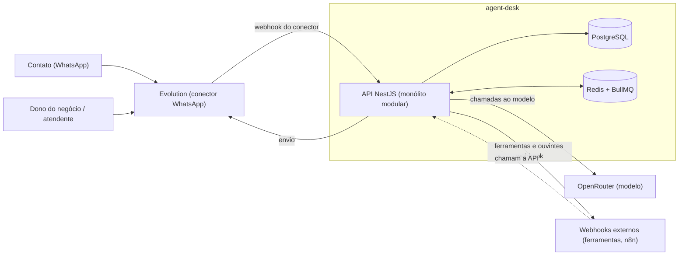
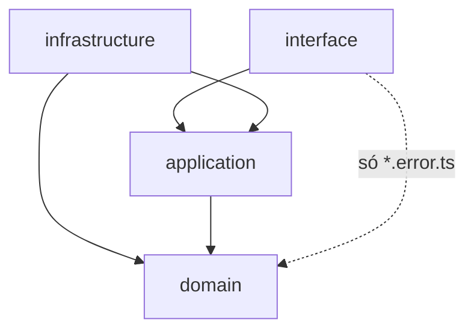
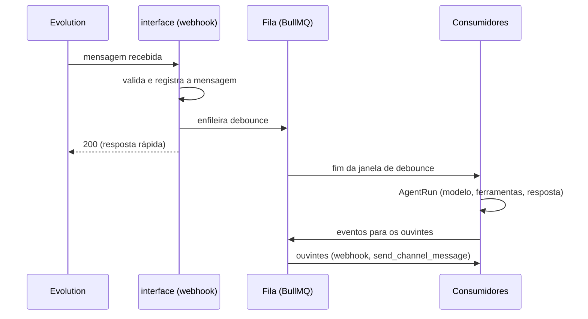

# Arquitetura

O agent-desk é um **monólito modular**: uma única aplicação, dividida em módulos com fronteiras claras, **sempre priorizando a simplicidade, mesmo que isso custe mais código**. O projeto precisa ser fácil de ler e entender.

Termos seguem o [glossário](../documents/ubiquitous-language.md).

## Componentes

| Componente | Papel |
|---|---|
| API NestJS | Único processo de aplicação. Recebe webhooks, executa casos de uso e consome a fila. |
| PostgreSQL | Fonte da verdade: conversas, mensagens, execuções, configuração. |
| Redis + BullMQ | Fila e agendamento: debounce, `AgentRun`, ouvintes de eventos, atrasos de digitação. |
| Evolution | Conector do WhatsApp (primeira implementação de `ChannelConnector`). |
| OpenRouter | Provedor de modelo (primeira implementação de `LlmProvider`), com a chave cadastrada pelo usuário. |
| Webhooks externos | Ferramentas do agente e ouvintes de eventos que chamam sistemas de fora. |

## Módulos

Cada módulo corresponde a um contexto de [`documents/contexts/`](../documents/contexts/), mais `settings` e um `shared` mínimo.

| Módulo | Contexto |
|---|---|
| `channels` | [Canais](../documents/contexts/channels.md) |
| `conversations` | [Conversas](../documents/contexts/conversations.md) |
| `agent` | [Agente](../documents/contexts/agent.md) |
| `tools` | [Ferramentas](../documents/contexts/tools.md) |
| `events` | [Eventos](../documents/contexts/events.md) |
| `sending-guards` | [Travas de envio](../documents/contexts/sending-guards.md) |
| `content-guard` | [Lista negra](../documents/contexts/content-guard.md) |
| `usage` | [Gasto](../documents/contexts/usage.md) |
| `settings` | Configurações da instalação (sem contexto próprio em `documents/`). |
| `shared` | O mínimo comum a todos. Não é "utils" genérico: só entra o que dois módulos já usam de fato. |

## Camadas

Todo módulo segue as mesmas quatro camadas.

| Camada | Contém | Pode depender de |
|---|---|---|
| `domain` | Entidades, value objects, regras, eventos de domínio, erros de domínio. TypeScript puro, sem Nest, sem Drizzle. | Nada fora do domínio, exceto `node:crypto` (veja [`code/layers.md`](code/layers.md)). |
| `application` | Casos de uso (uma classe por caso de uso) e as portas (classes abstratas) que eles usam. | `domain` |
| `infrastructure` | Implementações das portas: repositórios Drizzle, conector Evolution, OpenRouter, BullMQ, cliente HTTP de webhooks. | `application`, `domain` |
| `interface` | Controllers HTTP, consumidores de fila, DTOs de entrada e saída. Sem regra de negócio. | `application` e os erros de domínio (`*.error.ts`) do próprio módulo, para traduzi-los para HTTP. |

### Regra entre módulos

Um módulo só usa outro **pela camada `application` dele**, nunca por `domain` nem por `infrastructure`. Se `conversations` precisa de algo de `channels`, ele depende de um caso de uso ou de uma porta exposta pela `application` de `channels`.

### Regras de fundação

- **Portas são classes abstratas**, usadas diretamente como token de injeção do Nest. Não há tokens em string.
- Repositórios convertem linhas do banco em entidades de domínio. Tipos do Drizzle nunca saem da infraestrutura.
- O módulo Nest é só a fiação: liga portas a implementações.
- Erros de domínio são classes tipadas. A camada `interface` traduz para HTTP.
- As regras de dependência entre camadas e entre módulos são convenção, verificada na revisão do PR.
- **Proibido:** repositório genérico, herança profunda, biblioteca de CQRS ou event sourcing, abstração sem um segundo caso real, "utils" genérico.

## Fronteira síncrona e assíncrona

- **Síncrono:** o webhook do conector responde rápido. Ele só valida, registra e enfileira.
- **Assíncrono (pela fila):** a janela de debounce, o `AgentRun`, os atrasos da simulação de digitação e os ouvintes de eventos.
- Uma falha de ouvinte não afeta quem emitiu o evento. Ouvintes têm novas tentativas.
- Eventos de domínio são emitidos pelo módulo dono do fato e entregues aos ouvintes pelo módulo `events`. Exemplo: o módulo `conversations` emite `ConversationHandedOff` em toda troca do dono da conversa do agente para o humano. Outros módulos que causam o handoff (como `agent`, `usage` e `sending-guards`) pedem a troca a `conversations` pela `application` dele, e é `conversations` quem emite o evento.

## Instalação e deploy

- **Instalação única:** cada instalação atende um único negócio. Não há multi-tenant.
- **Desenvolvimento local por docker-compose:** `postgres`, `redis` e `api`. A Evolution entra em um perfil opcional (`evolution`).
- **Deploy no Coolify:** a API construída pelo `apps/api/Dockerfile`, com `HEALTHCHECK` em `/health`, e Postgres e Redis como recursos do Coolify. Passo a passo em [`workflow/deploy.md`](workflow/deploy.md).
- Um Dockerfile por app. A configuração vem de variáveis de ambiente, validadas na subida: a aplicação não sobe com configuração inválida.
